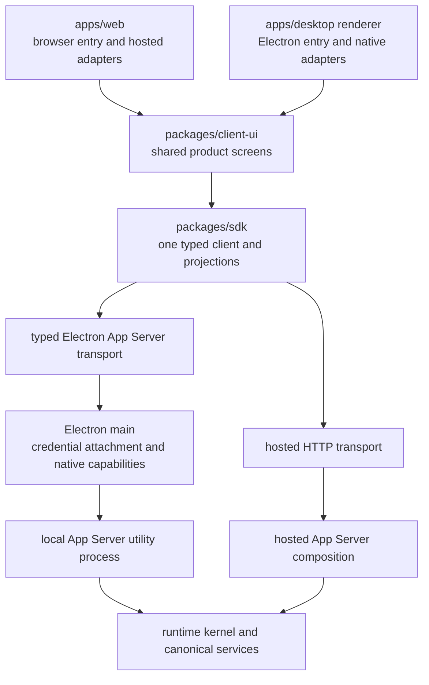
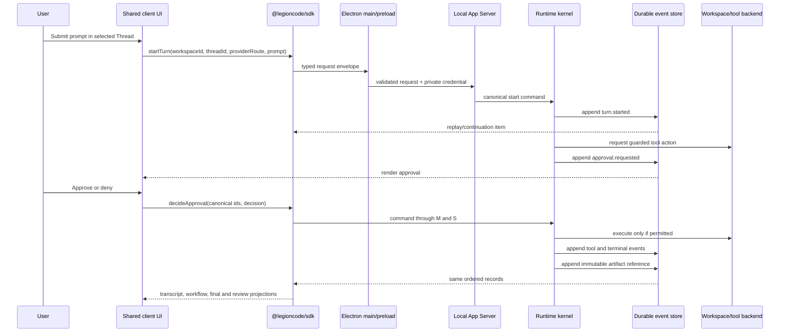

# LLD 057 — Local-First Desktop Golden Loop

Date: 2026-09-27

Parent:
`plans/rebuild/product-plans/057-LOCAL-FIRST-DESKTOP-VERTICAL-SLICES-AND-SHARED-CLIENT-EXTRACTION-PLAN.md`

Status: Authoritative full-plan execution LLD. PRs 057.1 through 057.5 and
corrective 057.C1 are merged to `dev`. PR #442 merged at
`eb6e70ebaa164b8249b4547439399a404dae2d35` on 2026-10-03 (Asia/Kolkata),
after all required checks and an independent Sol-high review recorded on
revision `95841e3ae9a2d81b95211727d45595a66130fe04`. 057.C2 merged in PR #445 at
`7b916e03dabff701a165a91927f7ba87fa649a7b` on 2026-10-03, after all required
checks and both macOS packaged product tests passed. Its independent Sol-high
review is recorded on revision `44ec796f624ff72337cd1fd76121566bc3b5b865`;
CodeRabbit skipped `dev` and is not counted as substantive review. 057.6A is
complete in PR #446, merged at `00f1401d15cb39c66734daa7e5bb53431bf6d65d`
on 2026-10-04 (Asia/Kolkata), with independent Sol-high review `5402936741`
on revision `9b17fce2088d421035d22c55f115dcc2bfba7a7a`. All required remote
gates and final packaged acceptance passed; acceptance is recorded in PR
comment `5973923782`. 057.6B is complete in PR #447, merged at
`2e9c652a5ffa4149478d826019feb7570ffb3c31` on 2026-10-04 (Asia/Kolkata),
with independent Sol-high architecture/security review `5407466061` on exact
revision `ba4a741943ebcb018be2ead9e1bb9536eb1806bc`. All required remote gates
and macOS package acceptance passed. Actual protected credential save/replace/
restart/delete, native privilege isolation and existing workspace/grant proof
passed 3/3; acceptance is recorded in comment `5982919479`. Both clients consume
the same existing provider chooser/icon and shared styles; hosted Web policy
remains unchanged. No Turn starts in this slice. 057.6C is beginning from the
new latest `origin/dev`, with shared conversation/composer and read-only native
execution still required. Later product slices remain pending. This
LLD replaces the earlier interpretation that it covered only the corrective
work: completing every gate in this document completes Plan 057.

Approved sequencing note (2026-10-10, Asia/Kolkata): execute Plan 058's
Web-first extraction and hosted-authority slices before resuming unfinished
057.6C native execution. Preserve merged Desktop work and the recovery worktree.
During 058, an immediately wired Web consumer suffices for extraction while
Desktop continues to compile. Resume 057 against the reviewed, merged shared
boundaries; its native golden-loop acceptance remains unchanged. Neither 056
nor 057 is completed by this order change.

This document authorizes no branch, worktree, commit, push, PR, merge, reset,
stash, or deployment operation by itself.

Subscription parallelization addendum (2026-11-06, Asia/Kolkata): the user's
request permits Mac delivery alongside local subscription work in Plan 048 and
cloud subscription work in Plan 061. The blanket serial sequencing above is
narrowed to per-capability dependencies. Consume merged 058 boundaries as
needed; do not require full 058 closure for independent Mac work. Local
mutating adapters still need admission/replay, enforceable permissions,
approval/Stop, checkout lease and immutable artifacts. Installed Mac release
still needs packaged acceptance; cloud does not wait for 057.8. This LLD
remains the sole Desktop completion authority and its acceptance is unchanged.

Independent harness clarification (2026-11-06): Codex, Claude Agent and OpenCode
v2 are initial-scope independent tracks in 048/061. They do not wait for 057,
058, Native inference or another driver. Missing in-path capabilities are wired
through canonical owners by the integration slice itself. Desktop consumes the
resulting SDK/App Server integration and adds its installed-app proof; the
capability gates above are not prerequisites on the integration's roadmap.

Cloud/local clarification (2026-11-06): follow the
[ACP versus native decision](../../../../architecture/HARNESS-TRANSPORT-DECISION.md).
Mac cloud connects through the hosted SDK/App Server to Web's same cloud
environments and Threads; Mac local uses the loopback App Server. Both host
compositions reuse the Codex app-server, official Claude Agent SDK and native
OpenCode v2 packages. Keep credentials, workspace and process ownership bound
to the selected environment; no silent handoff or local credential upload.
Prove installed Mac/cloud and Mac/local paths for every advertised harness,
including hosted reattachment after client loss and local restart/replay.
This is harness feature acceptance alongside the local golden loop, not a
second renderer architecture or a predecessor for 048/061 implementation.

## 1. Purpose

Plan 057 is building one accountless local Desktop product over the same
LegionCode client, SDK, App Server, runtime, event, approval, artifact, and Git
model used by Web.

This LLD exists because the first five slices proved several individual
capabilities but did not define their final wiring precisely enough. The
resulting code is demoable, but the Desktop renderer currently uses a growing
domain-specific IPC facade, the shared application UI is incomplete, and the
unfinished 057.6 work mixes UI extraction, provider configuration, persistence,
and runtime integration.

The correction is incremental. Keep the valuable merged behavior, replace the
wrong boundary before adding more commands, and remain demoable after every PR.

The completed product path is:

```text
launch Desktop
-> local App Server becomes ready
-> grant one Git workspace
-> create or reopen a durable Thread
-> select an existing provider/model route
-> start one native LegionCode Turn
-> stream canonical commentary/tool/approval/final lifecycle
-> approve or interrupt through runtime commands
-> persist one terminal outcome
-> review the immutable completed-turn diff
-> commit through the canonical Git service
-> restart Desktop
-> reproduce the same Thread, Turn, workflow, final response, and review
```

## 2. Mandatory Reading Order

Before editing a slice, read:

1. `AGENTS.md`
2. `local/architecture/RUNTIME-ARCHITECTURE.md`
3. `local/architecture/CAPABILITY-OWNERSHIP.md`
4. the parent Plan 057
5. this LLD
6. only the files owned by the selected slice

When the repository moves the two architecture documents to a tracked
`architecture/` directory, use the tracked copies. Until then, every ownership
change must be stated explicitly in the PR description because ignored local
documents are not review evidence.

## 3. Existing Baseline

### 3.1 Implementation audit on 2026-09-27

The C1 implementation is directionally correct but not complete.

- PR #442 contains five coherent commits and replaces the active Web-only
  sidebar with one SDK projection and one `client-ui` workspace/sidebar
  implementation consumed by Web and Desktop.
- The branch is pushed and clean, but the PR remains open and `UNSTABLE`.
- The PR changes 33 files (`2955+ / 2189-`). That is larger than the normal
  Plan 057 review target, but most of the breadth is the atomic migration and
  deletion of the replaced Web sidebar. Do not add more scope to this PR.
- There is no recorded GitHub review. A private agent review is useful input,
  but it does not satisfy the required substantive PR review by itself.
- The architecture boundary check fails because
  `apps/web/src/lib/session-sidebar-selectors.ts` became a real SDK consumer
  without the SDK-import boundary gate being updated deliberately.
- The packaged macOS smoke fails because the second test sets a wide
  1100-pixel viewport and then expects the compact sidebar state. The product
  and the assertion disagree; make the viewport and expected state explicit
  instead of adding timing or retry logic.
- The rebuild-governance gate fails because the PR body does not contain the
  exact canonical-wiring metadata fields required by the gate. Its claim that
  this gate passed is currently false and must be corrected.
- The old `codex/057-6-local-native-turn` worktree remains four commits ahead
  of `origin/dev` with additional unstaged and untracked changes spanning a
  duplicate UI extraction, credential vault, and second lifecycle file store.
  It is not a valid baseline for any remaining slice and must not be merged or
  copied wholesale.

Review verdict: keep the C1 architecture and commits, fix the three failing
gates, obtain a substantive review of the final revision, and merge it before
starting C2. Do not rewrite C1 or fold C2 into PR #442.

Do not rebuild these working foundations without a demonstrated defect.

| Slice | Merged value to preserve | Remaining obligation |
| --- | --- | --- |
| 057.1 | sandboxed Electron renderer, typed preload, packaged macOS artifact, packaged smoke | signing, updates, and additional OS support stay deferred |
| 057.2 | shared root tokens, loading state, error boundary, environment status | actual workspace frame, sidebar, conversation, and responsive navigation are not yet shared |
| 057.3 | supervised loopback utility process, per-launch credential, handshake, restart/offline status, public SDK package identity | renderer still does not consume product commands through the SDK boundary |
| 057.4 | one-time sender-bound picker token, canonical Git-root validation, durable grant and revocation | workspace presentation must move into the shared application surface when Web consumes it |
| 057.5 | durable local thread events, canonical thread projector, restart replay, renderer-storage independence | shared thread/sidebar read model and UI were not completed |

Current status is therefore:

```text
057.1 complete
057.2 partial
057.3 complete for process/handshake only
057.4 complete
057.5 partial
057.C1 complete: PR #442 merged, reviewed and green
057.C2 complete: PR #445 merged, independently reviewed and green
057.6A complete: PR #446 merged, independently reviewed and green, packaged smoke 2/2
057.6B merged #447 / 2e9c652a
057.6C in progress from new latest origin/dev
057.6D through 057.8B pending
```

## 4. Fixed Architecture Decisions

These decisions are not open to reinterpretation during implementation.

### 4.1 One product, two client entries

Web and Desktop compile the same shared product screens. They do not import
from each other's app directories.



`packages/client-ui` owns presentation and interaction composition. It does not
own durable product state, lifecycle truth, filesystem access, credentials, or
transport policy.

### 4.2 The renderer consumes the SDK

The Desktop renderer must not grow one preload, IPC-main, supervisor, and SDK
method for every App Server command.

The required request path is:

```text
shared UI/controller
-> @legioncode/sdk method
-> injected AppServerTransport
-> one typed preload request channel
-> Electron main validates the envelope and attaches the private credential
-> local App Server
```

Use one request channel. Add one event/subscription channel only in the slice
that first consumes canonical live continuation. The request is a versioned
discriminated envelope validated by existing protocol schemas. Do not expose
raw `ipcRenderer`, arbitrary URLs, arbitrary HTTP methods, arbitrary filesystem
paths, the App Server base URL, or its credential.

Electron main forwards validated envelopes. It does not implement thread,
turn, approval, artifact, provider, or Git business rules.

Native operations remain narrow Desktop ports because they are not App Server
transport:

- choose a directory and return an opaque one-time selection token;
- write/read/delete provider secrets through OS-protected storage;
- open an external link;
- show a notification;
- application lifecycle and update operations.

Do not add any native port until its current slice uses it.

### 4.3 One App Server package

Keep one `packages/app-server`. It owns the versioned request handlers and
local/hosted composition boundaries.

The server is divided by plain modules, not a routing framework:

```text
packages/app-server/src/
  server.ts                 request parsing, auth and dispatch only
  initialize.ts             handshake and capability truth
  workspaces.ts             workspace commands and queries
  threads.ts                thread commands and queries
  turns.ts                  added only in 057.6
  approvals.ts              added only when approvals are wired
  artifacts.ts              added only in 057.7
  local-process.ts          local listener and composition
```

This is a target layout, not permission to create empty files. Extract each
module only when its responsibility is touched. No registry, controller base
class, dependency-injection framework, or parallel server package is allowed.

### 4.4 Canonical ownership

| Responsibility | Canonical owner | Clients may do |
| --- | --- | --- |
| workspace grant | App Server workspace service | request and render |
| Thread commands | App Server over canonical event append | request and render SDK projection |
| Turn/run lifecycle | runtime kernel | request, replay, and render |
| approvals | runtime kernel plus permission policy | display request and send typed decision |
| provider/model execution | existing provider catalog and adapter boundary | select a route and submit credential through native secret port |
| tool execution | runtime tool registry/policy | render typed tool lifecycle |
| transcript/workflow | SDK projections over canonical replay | render only |
| completed review | immutable turn artifact/diff | render only |
| Git mutation | canonical Git service | send explicit command |
| local process and OS integration | Electron main | expose narrow validated native ports |

No Desktop-specific runtime, lifecycle, provider adapter, event schema,
approval state machine, artifact model, or Git service may be created.

### 4.5 One local persistence composition

Do not create a different durable JSON file or store implementation for every
capability.

The local App Server must have one local persistence composition and one writer
authority. Existing `EventStore` and `LifecycleEventStore` ports may remain
separate domain interfaces, but their local implementations must share one
append-oriented durable backend, transaction owner, recovery policy, and data
directory.

Required properties:

- append cost does not rewrite the complete history;
- batches commit atomically;
- Thread and Turn identity remain queryable;
- idempotency keys and sequence constraints are enforced durably;
- a partial final write is detected and recovered explicitly;
- restart replay uses the same records that powered live continuation;
- only the App Server/runtime process writes;
- renderer storage is never involved.

Before 057.6 emits lifecycle events, choose and document the smallest backend
that satisfies those properties. A single local database is preferred over
multiple capability JSON files. Do not merge `FileLifecycleEventStore` as a
second whole-file-rewrite log.

### 4.6 Shared UI boundary

Share user-visible product surfaces, not only wrapper `<div>` elements.

`packages/client-ui` should contain only components consumed by both clients:

```text
client-ui/
  shell/             root loading, error and environment presentation
  workspace/         responsive workspace frame and top bar
  navigation/        workspace and Thread sidebar presentation
  conversation/      transcript, workflow and composer presentation
  review/            added only in 057.7
```

Shared components receive SDK read models and narrow callbacks. They do not
import Electron, browser authentication, Brain controllers, persistence,
runtime packages, or concrete transports.

Web and Desktop keep only their entry composition and platform adapters. CSS
that controls a shared screen lives with shared client UI. Window chrome,
native menus and updater presentation remain Desktop-specific.

### 4.7 Provider configuration

057.6 supports one verified provider route for the golden loop, but it must not
create an OpenAI-only Desktop runtime or duplicate an existing provider
adapter.

Required path:

```text
existing provider catalog
-> shared provider/model selection
-> Desktop native credential port stores the secret
-> local App Server receives a credential handle/configuration
-> existing provider adapter performs inference
```

The renderer may hold the secret only while the user submits the form. It must
clear it after settlement and must never persist or log it. Provider and model
selection must come from the existing catalog; do not hardcode `openai` or
`gpt-4o-mini` in the Desktop entry.

OS storage is a credential backend, not a new provider integration.

### 4.8 Replay and live continuation

The SDK owns one replay-plus-continuation algorithm for Web and Desktop:

```text
load durable snapshot/replay
-> remember last accepted sequence
-> attach live continuation
-> validate identity and ordering
-> project typed workflow/transcript/status
-> stop only on one durable terminal event
```

Desktop must not use a second event listener or React state machine to infer a
terminal result. Process loss changes environment connectivity; it does not
manufacture Turn completion or failure.

## 5. Corrective Slices Before 057.6

### 057.C0 — Reconcile the unfinished branch

This is a review/branch-hygiene action, not a product PR.

The existing `codex/057-6-local-native-turn` worktree contains committed and
uncommitted changes for multiple responsibilities. Inventory every change and
classify it as:

- retain for 057.C1;
- retain for 057.C2;
- retain for later 057.6;
- delete because it creates an OpenAI-specific or duplicate runtime path.

Do not merge, force-push, reset, discard, or cherry-pick anything without the
user's explicit Git authorization. The output is a proposed recovery map.

Exit gate: every current file and commit has one named destination; no hidden
WIP is treated as the next PR baseline. As of 2026-09-27 this gate remains
open; the dirty `codex/057-6-local-native-turn` worktree is preserved for
evidence only until the user authorizes its recovery or archival.

### 057.C1 — Shared workspace frame and Thread sidebar

Objective: finish the obligations left incomplete by 057.2 and 057.5.

Implement only:

- shared responsive workspace frame;
- shared top bar geometry;
- shared workspace/Thread sidebar presentation;
- one SDK Thread read model used by Web and Desktop;
- thin Web and Desktop adapters for their existing data/actions;
- deletion of replaced Web and Desktop sidebar markup.

Do not add conversation extraction, providers, lifecycle persistence, runtime
execution, approvals, or artifacts.

Acceptance:

- Web and Desktop render the same sidebar component from `client-ui`;
- both use the same SDK read model;
- local-only and hosted state are data, not separate component trees;
- archive, rename, select and empty/loading/error behavior remain truthful;
- keyboard focus and narrow-window behavior work;
- Desktop packaged smoke and focused Web tests pass;
- no duplicate sidebar implementation remains active.

Current closeout gate for PR #442:

1. Update the SDK-import boundary intentionally for the new sidebar adapter;
   do not weaken the gate into a broad app-wide exception.
2. Correct the packaged test's viewport/state contradiction and prove wide and
   compact behavior deterministically.
3. Supply the exact canonical-wiring metadata required by rebuild governance
   and remove claims for checks that have not passed.
4. Run the focused and required checks on the final revision.
5. Obtain a substantive review, resolve every P1/P2, and merge to `dev`.

### 057.C2 — SDK-controlled Desktop transport

Objective: correct the client boundary before adding Turn commands.

Implement only:

- internal typed App Server request/response envelopes;
- SDK transport injection;
- one preload request channel;
- main-process validation, credential attachment and forwarding;
- migration of existing initialize/workspace/thread SDK consumers;
- deletion of product-specific IPC handlers and supervisor pass-through
  methods replaced by the transport.

The folder picker, build information, environment status, and restart action
may retain narrow native IPC methods because they are Desktop capabilities,
not App Server product commands. Provider credential and lifecycle
continuation channels are not added in this slice.

Acceptance:

- the Desktop renderer calls `@legioncode/sdk` for App Server operations;
- Electron main contains no Thread business methods;
- base URL and per-launch credential never reach the renderer;
- malformed or unknown envelopes fail closed;
- Web continues using the same SDK through hosted transport;
- workspace and Thread packaged smoke behavior is unchanged.

## 6. Remaining Product Slices

### 057.6A — One local durable event backend

Execution decision (2026-10-03): the local App Server opens one
`LocalPersistence` composition from the Node-only `@repo/event-store/local`
entry and injects its existing EventStore, LifecycleEventStore and workspace
grant ports. One SQLite connection owns transactions and writer exclusion;
WAL/FULL durability and actual exclusive-lock acquisition are verified. The
native driver must work in both Node source checks and the packaged Electron
utility process. It must never enter SDK/browser/renderer exports.

Migration preserves every legacy event and grant identity, timestamp and
sequence in one transaction. Platform retry fingerprints exclude only the
four store-assigned fields (`eventId`, `cursor`, `sequence`, `createdAt`);
lifecycle retry fingerprints retain the full runtime-produced envelope. This
corrects the existing file store's inconsistent append/reopen fingerprint.
Legacy files become inert recovery evidence after the migration marker, not a
fallback read path. Corruption or an unexplained missing migrated database
must fail startup without deleting evidence or reporting empty healthy state.

Review evidence (2026-10-04 Asia/Kolkata): existing schema, indexed envelopes,
non-partial uniqueness constraints, primary keys and rowid aliases are checked
before any WAL/schema mutation. Process proof covers retained writer exclusion,
pre-COMMIT rollback and post-COMMIT replay. Focused SQLite proof passed 24/24;
full event-store proof passed 49/49. Final local unsigned arm64 DMG/ZIP packaging
and packaged smoke 2/2 passed on the reviewed revision, as did GitHub macOS
package run `37156588148` and required CI run `37156588166` (attempt 2 after a
transient Electron download 503). Local full build 32/32, types 26/26 and lint
21/21 passed, together with required conformance/boundary/capability/governance
gates. Hosted worker dry-run and Web build passed without native storage in the
worker bundle. The authenticated cloud route browser case was skipped without
its login fixture and is not counted as successful cloud acceptance. These
prove 057.6A only; the installed complete golden loop remains open.

Implement:

- the one append-oriented local persistence composition;
- migration of existing local Thread records without dual-write authority;
- one writer, transaction/recovery policy, data directory, sequence rule, and
  idempotency rule for local Thread and lifecycle records;
- removal of the whole-file `thread-events.json` rewrite path after migration.

Do not add providers, credentials, Turn execution, continuation, or new UI.

Acceptance:

- existing 057.5 Threads replay identically after migration;
- no whole-history rewrite happens per lifecycle append;
- a crash or partial write has one explicit recovery outcome;
- duplicate sequence/idempotency writes fail or converge deterministically;
- the old writer is deleted and no dual-write compatibility path remains.

### 057.6B — Provider catalog and OS-protected credential

Implement:

- provider/model catalog query through the SDK and App Server;
- one Desktop native credential adapter using the existing credential
  contract and primary-OS protected storage;
- a credential handle/configuration passed to the local App Server without
  exposing the secret to durable events or renderer storage;
- the smallest shared provider/model selection surface only if Web is a real
  consumer in this slice; otherwise keep the Desktop composition thin and
  extract when the second consumer exists.

Do not start a Turn yet and do not create an OpenAI-specific Desktop adapter.

Acceptance:

- the catalog, not the Desktop entry, supplies provider and model IDs;
- save, replace, delete, missing, and unavailable credential states are
  explicit;
- secret values are absent from logs, events, snapshots, crash diagnostics,
  renderer storage, and App Server responses;
- local-only setup requires no LegionCode account or cloud control plane.

### 057.6C — Native Turn, replay and final settlement

Implement one vertical path through existing runtime contracts:

- create Turn and Run Attempt with canonical IDs;
- bind execution to the granted workspace;
- call the existing provider adapter;
- add the single typed continuation channel now that the product consumes it;
- stream canonical commentary and typed tool items;
- append before live delivery;
- settle exactly one completed or failed terminal outcome;
- persist transcript and replay the same result after restart.

Initial tool scope is inspect/read only. Guarded edits and command execution
remain unavailable until 057.6D wires canonical permission enforcement and
approval settlement. That slice enables the approved edit and test command
required by the final golden loop. Do not create Desktop tools.

Execution decision from the 2026-10-04 runtime trace: the existing RuntimeKernel
unconditionally requires artifact capture before admitting a Turn. 057.6C may
use an explicit runtime-owned read-only capability that omits artifact capture
entirely, rather than inventing snapshots, empty diffs or no-op artifact ports.
Existing cloud capture remains mandatory and unchanged. This exception cannot
authorize guarded writes/commands or present completed-review artifacts; a
mutating capability must use the canonical capture/settlement ports. 057.7A
still owns the full local immutable completed-review acceptance.

Provider extraction decision from the same trace: concrete inference adapters
currently import execution-engine usage/transcript types and its unusable-response
error. Move those existing implementations into execution-engine's existing
runtime/provider boundary for both Brain and local runtime composition; keep
catalog/model-route policy in provider-core. Do not invert provider-core into
an execution-engine dependency or copy adapters into Desktop. Preserve hosted
credential/default/typed-error policy at Brain's composition boundary. Native
calls supply the chosen catalog model explicitly, with no default-provider path.

Admission and prompt/history must use existing canonical platform records,
written atomically by the same local persistence authority. Runtime supplies
the canonical admission; App Server does not append competing lifecycle or
terminal status. A repeated Thread-scoped admission key converges only when
its normalized request matches, otherwise it conflicts. Replay must discover
the admitted Turn and user message without renderer storage or a transcript
file. Admission lookup stores only identity, key/fingerprint and canonical-event
references; it is an index, not another persisted copy of the prompt, Run, Turn
or transcript. History reconstructs those records from the existing platform
events. Persistence validates and commits runtime-produced records rather than
choosing their product status or timestamps. Process loss leaves an unowned unfinished attempt visibly unsettled; it
does not automatically resume inference or fabricate a terminal outcome.

Acceptance:

```text
prompt
-> runtime reads workspace
-> durable commentary/tool lifecycle appears
-> final response settles once
-> restart
-> identical transcript/workflow/final state
```

### 057.6D — Approval and interruption

Implement:

- canonical approval request and decision;
- permission-policy enforcement before the guarded tool action;
- runtime interrupt command;
- provider/tool/process cancellation;
- exactly one interrupted terminal event;
- restart replay of approval and interruption state.

Acceptance:

- renderer cannot bypass approval;
- denying approval prevents the action;
- Stop cannot leave a running spinner or active process;
- process/environment loss cannot invent terminal Turn state;
- repeated decision or interrupt commands are idempotent.

### 057.7A — Immutable completed-Turn artifact and diff

Implement:

- baseline and final capture through canonical artifact ownership;
- immutable completed-turn diff;
- explicit live-workspace review as a different scope;
- failed/interrupted artifact settlement.

Acceptance:

- completed review remains identical after unrelated workspace changes;
- restart reproduces the same artifact and diff;
- live Git is never substituted for completed-turn truth.

### 057.7B — Shared review and canonical Git completion

Implement:

- one SDK artifact/review projection;
- shared changed-file and review UI consumed by Web and Desktop;
- explicit commit command through the canonical Git service;
- success and typed failure presentation without shelling out from a client.

Acceptance:

- Web and Desktop render the same review component and SDK read model;
- the renderer cannot supply an arbitrary filesystem path or raw Git command;
- commit targets the granted workspace and selected immutable Turn artifact;
- commit failure does not mutate Turn terminal truth or lose the artifact.

### 057.8A — Clean-profile local golden-loop proof

This is integration hardening and deletion, not another architecture layer.

The source-based Electron comparison recorded in PR #447 comment `5982945563`
identified a current shutdown-proof gap: supervisor timeout can report stopped
cleanly without proving process exit. This slice must verify actual child exit
and orphan-free shutdown rather than treating elapsed timeout as success.

Prove on a clean primary-OS profile:

- install and first launch;
- workspace grant and revocation;
- provider setup and secret recovery;
- Thread/Turn creation;
- tool approval and denial;
- edit and test;
- interrupt and failure;
- final response;
- immutable review and commit;
- full restart replay;
- diagnostics for corrupt/unavailable local state;
- clean shutdown with no orphan process.

Delete temporary diagnostics, migration-only code and superseded paths before
this slice closes.

### 057.8B — Distributable local beta and plan closure

Prove the primary supported OS artifact from a clean machine/profile:

- install, launch, quit, restart, and uninstall/rollback behavior;
- renderer, IPC, loopback, credential, path, approval, and Git security gates;
- keyboard, focus, narrow-window, zoom, reduced-motion, and screen-reader
  critical-path behavior;
- bounded startup, replay, and long-transcript performance;
- diagnostic output that redacts secrets and repository contents by default;
- no LegionCode account, billing, cloud database, cloud worker, relay, or
  LegionCode public-service dependency in the local-only golden path. Network
  access to the user's explicitly selected inference provider is allowed.

Plan 057 closes only after the final revision is reviewed, green, merged to
`dev`, and the parent plan records the merge evidence.

## 7. PR Boundaries

One PR owns one row below. Subdivide again if a PR cannot be reviewed in one
sitting.

| PR | Product responsibility | Expected scope |
| --- | --- | --- |
| 057.C1 | shared frame/sidebar | client UI, SDK read model, Web/Desktop adapters |
| 057.C2 | Desktop SDK transport | SDK transport, preload/main forwarding, deletion of domain IPC |
| 057.6A | durable local event backend | migrate Thread events, one append owner, delete JSON rewrite path |
| 057.6B | provider and credential setup | existing catalog/adapter, native protected-secret port |
| 057.6C | native Turn and replay | App Server Turn methods, runtime wiring, continuation, shared conversation |
| 057.6D | approval and interruption | permission/runtime commands and projections |
| 057.7A | immutable artifact and diff | canonical capture, persistence and projection |
| 057.7B | shared review and Git completion | SDK/UI review surface and canonical Git command |
| 057.8A | clean-profile golden loop | end-to-end proof, recovery, diagnostics and deletion |
| 057.8B | distributable beta | security, accessibility, performance, packaging and closure evidence |

Rules:

1. Use a sequential merge train, not a long-lived dependent PR stack. Start
   each PR from the latest merged `origin/dev`; merge it before branching the
   next row. This preserves a demoable `dev` after every slice.
2. Target `dev`.
3. Never mix a package rename with behavioral implementation.
4. Prefer two to five coherent commits.
5. A commit should normally touch one responsibility and a small group of
   related files; large mechanical edits must be isolated and justified.
6. No speculative directories, `.gitkeep`, disabled production paths, test-only
   frameworks, compatibility facade, or second SDK/server/event owner.
7. Update this LLD before materially changing the boundary.
8. Do not merge merely because CI is green.

## 8. Required Review And Gates

Every PR must receive a substantive review. A skipped bot review or green
status context is not a review.

Before merge:

- one reviewer or separate review task examines architecture and code;
- every actionable finding is fixed or explicitly accepted by the user;
- latest required CI is green;
- the packaged Desktop smoke is green when Desktop is touched;
- focused Web tests are green when shared UI is touched;
- `git diff --check` passes;
- the PR description names the canonical owner and deleted duplicate path;
- the PR can be demonstrated from user action to result.

High-signal proof only:

- typed transport rejects malformed and unknown envelopes;
- renderer never receives App Server credentials or raw Node/Electron APIs;
- restart replay reproduces canonical state;
- approval and interruption settle once;
- immutable review survives later Git changes;
- local golden path succeeds without account or cloud dependency.

Do not add tests for static markup, pass-through getters, framework behavior or
types that cannot fail at runtime.

### 8.1 End-state directory ownership

Create or extract a file only when its slice wires a real producer and
consumer. Names below describe responsibilities, not mandatory empty folders.

```text
apps/desktop/
  src/main/
    server/          local App Server supervision and private transport
    credentials/     primary-OS protected credential implementation
    windows/         BrowserWindow policy and lifecycle
  src/preload/       typed App Server request/continuation + native ports
  src/renderer/      Desktop entry and Desktop-only composition
  tests/             packaged golden-path and security proof

packages/app-server/src/
  server             authentication, validation and dispatch only
  initialize         handshake/capabilities
  workspaces         workspace commands and queries
  threads            Thread commands and queries
  turns              Turn/interrupt/approval commands when first used
  artifacts          artifact/diff queries when first used
  local              local composition and durable adapters

packages/sdk/src/
  transport          injected request/continuation transport
  workspaces         typed client methods and projections
  threads            typed client methods and sidebar projection
  turns              replay + live continuation and transcript/workflow
  artifacts          immutable review projection

packages/client-ui/src/
  workspace          shared frame/top bar
  navigation         shared workspace/Thread sidebar
  conversation       shared transcript/workflow/composer when wired
  approval           shared approval/stop presentation when wired
  review             shared completed-Turn review when wired
```

Desktop-native code stays under `apps/desktop`. Canonical schemas remain in
`platform-protocol`; runtime policy stays in its current canonical packages.
Do not create `desktop-core`, `local-runtime`, `cloud-core`, another SDK, or a
second App Server package.

### 8.2 Request, continuation, and native-port boundary

The renderer receives two categories of capability and they must not blur.

| Boundary | Examples | Rule |
| --- | --- | --- |
| App Server request transport | initialize, list/create Thread, start Turn, decide approval, interrupt, read artifact, commit | one validated discriminated request envelope; main attaches destination and credential |
| App Server continuation | lifecycle items after a canonical sequence | one typed subscription added in 057.6C; replay remains authoritative |
| Desktop native port | folder picker, protected credential store, external link, notification, app lifecycle | narrow named methods; no arbitrary path, command, URL, keychain query, or raw Electron object |

Every request names the canonical IDs required by the operation. The renderer
must not reconstruct Thread, Turn, Run Attempt, Workspace, approval, or artifact
identity from labels or current selection. Unknown methods and invalid payloads
fail closed in preload/main and again at the App Server boundary.

### 8.3 Golden-loop sequence



Durable append precedes publication. Disconnecting the renderer or losing the
App Server process never fabricates a completed, failed, or interrupted Turn.

### 8.4 State and failure rules

- Environment state is `starting | ready | degraded | offline | stopped`; it
  is not Turn state.
- A Turn reaches one durable terminal state: completed, failed, interrupted,
  cancelled, or timed out.
- Approval decision and interrupt commands are idempotent and target the exact
  active Run Attempt.
- A denied approval settles the guarded Tool Call without executing it.
- Corrupt local persistence fails explicitly and preserves the original data;
  it is never silently replaced with an empty product.
- Credential unavailability asks for configuration; it never falls back to a
  different provider or cloud execution.
- Completed-Turn review reads the recorded artifact. Live-workspace review is
  a separately labeled query and cannot replace it.

### 8.5 Security threat model for remaining slices

| Actor or failure | Protected asset | Required control |
| --- | --- | --- |
| compromised renderer | App Server credential, filesystem, Git, provider secret | sandboxed renderer; narrow preload; validated envelopes; no raw Node/Electron |
| hostile local webpage/process | loopback App Server | loopback bind, per-launch secret, strict host/origin/method/body validation |
| malicious model/tool input | workspace and Git history | canonical workspace root, traversal/symlink defense, registry + permission policy, narrow Git service |
| duplicate/replayed command | lifecycle and artifact truth | canonical IDs, idempotency keys, durable sequence constraints, one writer |
| crash or partial write | replayable Thread/Turn history | atomic append/batch, explicit recovery, append-before-publish |
| diagnostics or crash report | provider secret and repository contents | redaction by default and no secret-bearing lifecycle payloads |

Security review is mandatory for C2, 6A, 6B, 6D, 7B, and 8B.

## 9. Stop Conditions

Stop the current slice and update this LLD before continuing if:

- two modules can mutate the same product state;
- a new App Server operation requires another end-to-end chain of domain IPC
  methods;
- a second local event file/store is introduced for convenience;
- Web and Desktop require copied feature markup;
- provider routing requires a Desktop-only adapter;
- a process crash is converted into a fabricated Turn terminal result;
- the real acceptance path requires refresh, retry, manual file repair or
  renderer storage;
- a PR combines two rows from the PR-boundary table;
- review is skipped or unavailable.

## 10. Completion Standard

Plan 057 is complete only when:

1. Desktop is downloadable and runs the local golden loop without login.
2. Web and Desktop use the same shared product UI for every migrated surface.
3. Both clients consume one `@legioncode/sdk` contract through different
   transports.
4. One App Server contract serves local and hosted composition.
5. Runtime remains the only Turn/tool/approval/terminal lifecycle owner.
6. Local persistence replays the same committed events used for live delivery.
7. Provider secrets remain OS-protected and provider routing reuses existing
   catalog/adapters.
8. Completed review comes from immutable artifacts.
9. No duplicated Desktop runtime, provider, lifecycle, event, approval,
   artifact, Git, sidebar, conversation or review owner remains.
10. Every PR was independently reviewed, green, demoable and merged to `dev`.
